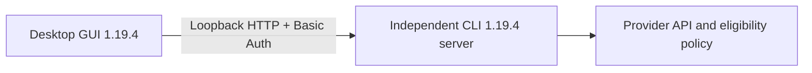

# OpenCode V1 holdout: keep the GUI, use the working CLI path

When `BigPickle` was selected in the desktop app, the API returned this exact, public-facing error:

```text
This version of OpenCode Desktop no longer supports free models. Update to the latest version at https://opencode.ai/download to keep using them.
```


The updater had already reported 1.19.4 as the latest desktop version. On an arm64 Mac running macOS 26.6.2, the desktop app had moved from 1.19.0 to 1.19.4 through its normal updater. The shell CLI was also 1.19.4, but it still offered the free model I needed. The desktop app did not.

I am quite happy with OpenCode TUI for months. The GUI installed on two of my macbooks have never been opened since the session db lost happened in June. I didn't realise that until my friend @sakanation found that OpenCode's desktop error message. The inconsistency of experience on GUI and TUI tickled me.

As OpenCode officially shifted the focus to V2, I might just log this workaround for users that heavily reliant on V1. (One of my device holds a lot V1 sessions. V1 sessions will be defaultly dropped [Maintainer Reply](https://github.com/anomalyco/opencode/issues/49827#issuecomment-6359007338))

* [OpenCode#46402](https://github.com/anomalyco/opencode/issues/46402) the db lost I've bumped into on Desktop GUI V1
* [Shift focus to V2](https://github.com/anomalyco/opencode/issues/46402#issuecomment-6112353559)
* [OpenCode #49827](https://github.com/anomalyco/opencode/issues/49827) V2 dropped V1 sessions, still open till 2026-10-27

## Root Cause that TUI & GUI diverged

The public 1.19.4 source shows that the desktop app starts a sidecar through `utilityProcess.fork` and sets `OPENCODE_CLIENT=desktop` in [`server.ts`](https://github.com/anomalyco/opencode/blob/v1.19.4/packages/desktop/src/main/server.ts#L44-L64). The shared runtime defaults the client flag to `cli` in [`runtime-flags.ts`](https://github.com/anomalyco/opencode/blob/v1.19.4/packages/opencode/src/effect/runtime-flags.ts#L56). The [`request.ts`](https://github.com/anomalyco/opencode/blob/v1.19.4/packages/opencode/src/session/llm/request.ts#L190-L196) path sends an `x-opencode-client` value derived from that flag, together with a user agent containing the product version.

This is enough to establish that the GUI and shell paths identify themselves differently. It is not enough to say that the server blocks free models on one header alone: I did not inspect a private gateway, and the public source does not expose the provider's complete decision rule. That distinction matters when documenting a workaround. The bridge preserves the CLI's normal behavior instead of rewriting client headers or making a promise about future server policy.

## The Bridge Reuse TUI



I retained the installed 1.19.4 CLI under a fixed service path, then ran it as a password-protected loopback server on `127.0.0.1:4096`. The original retention step used a hard link; that survives package-path cleanup but is not write protection against changes to the shared inode. The published helper improves this by making a separate byte copy and checking its digest. The password was newly generated for this local connection. I did not copy account credentials, session databases, or project data into the handoff, and I did not reset or move the existing session store.

In the desktop app I used Settings → Servers → Add server, entered the loopback URL and password, made that server the default, and opened the same project through it. This is the normal [external-server form](https://github.com/anomalyco/opencode/blob/v1.19.4/packages/app/src/components/dialog-select-server.tsx); the V1 server's [CORS rules](https://github.com/anomalyco/opencode/blob/v1.19.4/packages/server/src/cors.ts) already permit `oc://renderer`. I kept the GUI and server on V1 rather than assuming v2 API compatibility.

The `/global/health` endpoint returned `200` with `{"healthy":true,"version":"1.19.4"}`. The first BigPickle request returned `OK` in about four seconds. The final background-mode check returned `OK READY` in about ten seconds: an earlier unanswered instruction requested `OK`, and the final instruction requested `READY`. I count that as completed inference, not strict single-token instruction compliance.

## Making Bridge Survive Login

My first LaunchAgent used a Python wrapper that executed the CLI. The port appeared to be listening, but HTTP requests timed out. A thread sample showed the main thread blocked in `openat`, and macOS TCC diagnostics identified Python as the process responsible for the Documents access decision. I do not treat that as proof that Documents permission was the only possible cause of the timeout.

The working service invokes the pinned CLI directly, with `RunAtLoad`, `KeepAlive`, and a 30-second throttle interval. On this Mac I granted the lowercase `opencode` binary access to Documents in Files & Folders. I did not grant Python access or Full Disk Access. Health checks and GUI inference then worked through the background service. I configured and checked startup, but I did not log out, reboot, or claim a reboot test.

The public helper in [`src/opencode/v1-cli-bridge`](../src/opencode/v1-cli-bridge/) is a cleaned-up version of this idea, not a replacement for the live service. It verifies a downloaded or supplied release before execution, keeps its own support directory and LaunchAgent label, binds only to loopback, and never puts the server password in the repository. It also does not alter user-agent or client headers. Its rollback scope is deliberately narrow: its own files and service, not the desktop connection, macOS TCC grants, or an unrelated OpenCode installation.

Its 29 isolated tests cover failed provenance checks, path and service ownership, private credentials, interrupted publication, health redirects, port conflicts, and rollback. A separate macOS smoke check used the real official arm64 ZIP and real signature, architecture, and version checks, then exercised installation, idempotent reinstall, default secret redaction, and rollback in a disposable directory. Only release metadata was fetched; launchd operations were mocked, and no model request was made. Those tests supplement the source-host GUI result; they do not establish a second-machine deployment or a reboot result.

## Upstream Info

A repository member's main issue [#59387](https://github.com/anomalyco/opencode/issues/59387) confirms that V1 no longer supports free models and that the V1 updater stays on the 1.x line. The exact-error issue [#59378](https://github.com/anomalyco/opencode/issues/59378) was closed as a duplicate; the [member's closing comment](https://github.com/anomalyco/opencode/issues/59378#issuecomment-6449317914) directs users to v2. [#59003](https://github.com/anomalyco/opencode/issues/59003) reports the same 1.19.4 desktop failure with a successful CLI path and is also closed as a duplicate. The v2-versus-V1 compatibility report in [#58835](https://github.com/anomalyco/opencode/issues/58835) was closed as not planned. Its bot replies are not independent maintainer confirmation, and its discussion did not provide a supported V1 free-model fix.

The download question remains open in [#59616](https://github.com/anomalyco/opencode/issues/59616). I did not find a PR or backport that restores free-model support to the V1 desktop client. Related merged changes, such as [#57146](https://github.com/anomalyco/opencode/pull/57146) and [#57466](https://github.com/anomalyco/opencode/pull/57466), address reset timing and quota-dialog behavior, not this V1 client policy.

That evidence changed my goal. I was not trying to make the old desktop product pretend to be v2. My goal was just to keep the working V1 CLI as a local server and make the desktop app reuse TUI connection to API via documented external-server connection.

## What I would change upstream

An updater should report more than “latest.” It should distinguish major version and channel, show whether the installed client still supports the capabilities the user is using, and link directly to a reachable migration path. A deprecation banner should explain the compatibility cost before the user spends time updating into the same line. The desktop UI should show the connected server's version and client identity, and distinguish a historical error card from a current request failure.

The more durable fix is a capability handshake with an explicit support window. That would let a client say which free-model or provider features it can use without making the server infer too much from an opaque client split. I do not expect every old desktop line to receive permanent support. I do expect the transition to account for the user's cost of moving a project, session history, permissions, and local service.

| User decision | Proposed behavior | Acceptance check |
| --- | --- | --- |
| Stay on V1 or migrate | Show "latest in 1.x" separately from current-major availability and retired capabilities | A user can identify the installed line and migration requirement before retrying a model |
| Choose a backend | Show the server version and connection identity on each tab | Switching the default cannot be mistaken for migrating existing tabs |
| Diagnose readiness | Separate process, API, provider, and completed-request states | A green health check is never presented as proof of available model access |

This bridge is a local workaround, not a claim that V1 has been restored. It won't keep working if the server-side API policy was totally changed.

